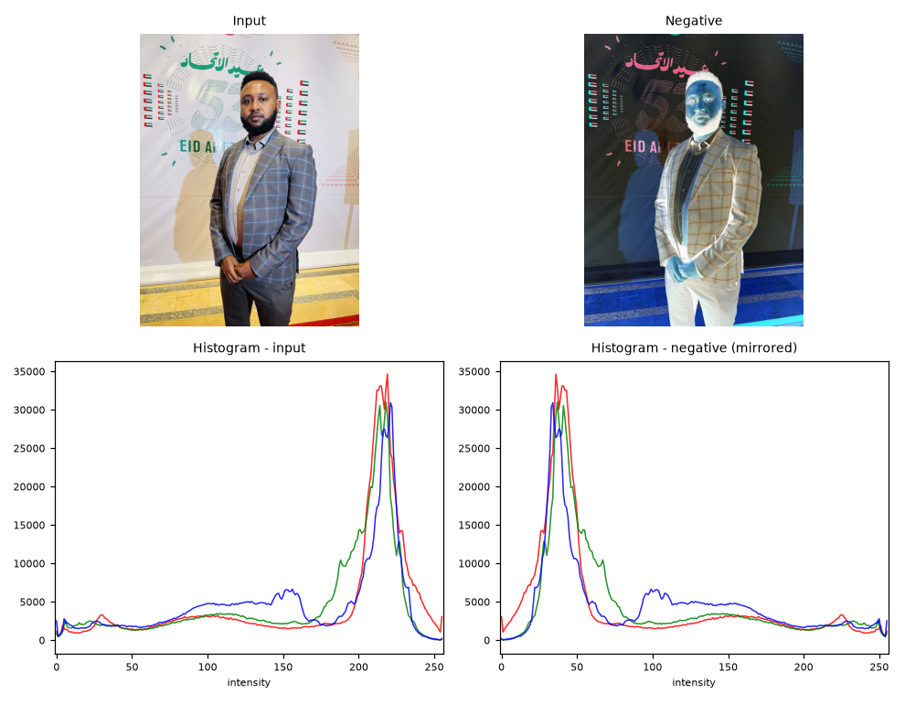
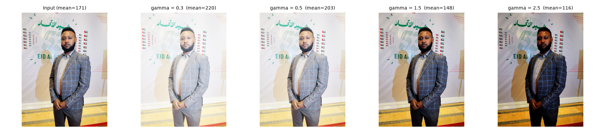
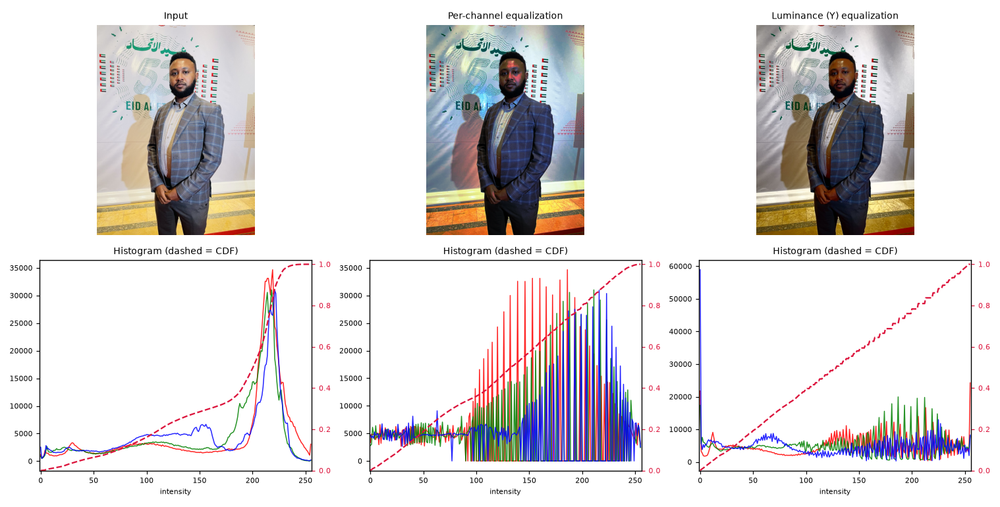
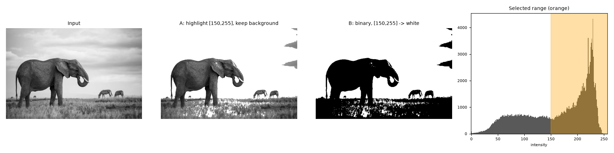
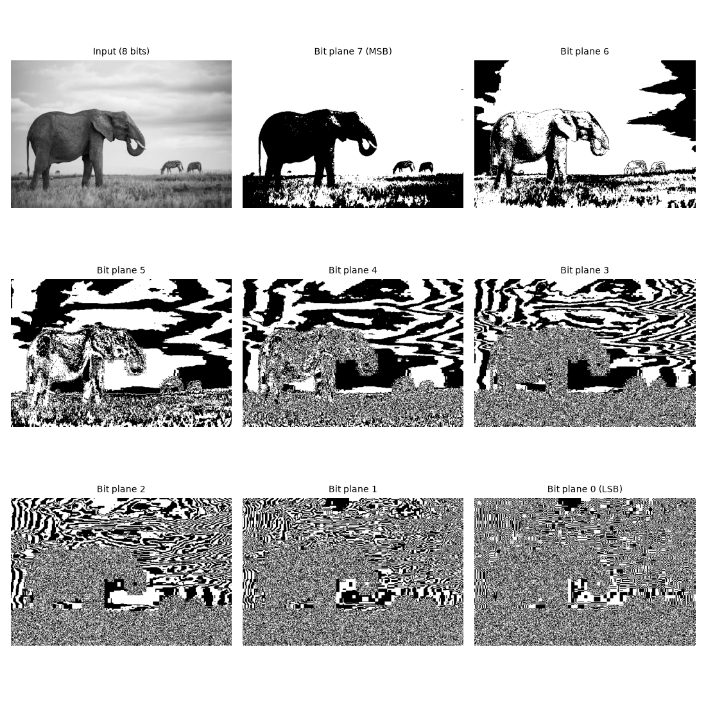
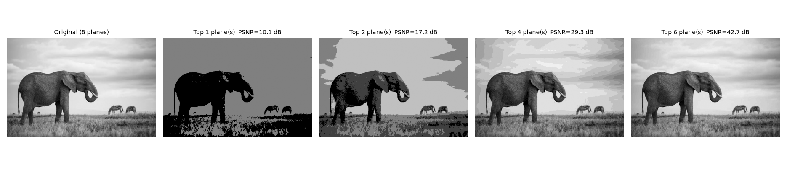

# Digital Image Processing: Elementary Methods

Computer Vision, Assignment 2 (individual). Seven classic point-processing methods implemented from scratch in Python with NumPy. Every method works on both **grayscale** and **RGB** images.

| # | Method | Formula |
|---|--------|---------|
| 1 | Image negative | `s = (L-1) - r` |
| 2 | Gamma (power-law) correction | `s = c * r^gamma` |
| 3 | Logarithmic transform | `s = c * log(1 + r)` |
| 4 | Contrast stretching | min-max, percentile, piece-wise linear |
| 5 | Histogram equalization | `s_k = round((CDF(k) - CDF_min) / (N - CDF_min) * 255)` |
| 6 | Intensity level slicing | highlight / binary mask for a band `[A, B]` |
| 7 | Bit-plane slicing | `plane_k = (r >> k) & 1` |

Here `r` is the input intensity, `s` the output intensity and `L = 256` gray levels.

---

## 1. Project structure

```
dip_assignment/
├── dip_elementary_methods.py     # all methods + experiments (single script)
├── images/                       # input images (a.jpg, b.jpeg, ...)
├── results/                      # generated figures, processed images, run_log.txt
│   ├── 00_transfer_functions.png
│   ├── 01_negative/   02_gamma/   03_log/   04_contrast/
│   ├── 05_histeq/     06_slicing/ 07_bitplanes/
│   │   └── outputs/              # the processed images as separate files
│   └── run_log.txt               # console output of the run
├── DIP_Elementary_Methods_Report.pptx   # presentation report (optional)
└── README.md
```

## 2. Installation

Python 3.9 or newer is recommended.

```bash
pip install numpy matplotlib opencv-python scikit-image
```

- `numpy` does all the image processing.
- `matplotlib` draws the figures and histograms.
- `opencv-python` reads and writes files and converts RGB to YCrCb (used only in histogram equalization for colour images).
- `scikit-image` provides the built-in sample images, so the script also runs offline without any photo.

## 3. How to run

```bash
# Built-in sample images (camera, moon, coins, astronaut, chelsea, coffee, ...)
python dip_elementary_methods.py

# Your own images: each one is processed twice, as RGB and as gray
python dip_elementary_methods.py --images images/a.jpg images/b.jpeg

# Also open every figure window
python dip_elementary_methods.py --images images/a.jpg --show

# Choose another output folder
python dip_elementary_methods.py --out my_results
```

On Windows PowerShell use backslashes if you prefer: `images\a.jpg`. Paths are relative to the folder you run the command from.

For each custom image `name`, the script creates `name_rgb` and `name_gray`, runs all seven methods on both, and writes the figures to `results/`.

## 4. How the code works (the whole process)

### 4.1 Common helpers
- `to_uint8` rounds and clips any array into the valid range 0..255.
- `to_gray` converts RGB to gray with the BT.601 luminance weights `0.299 R + 0.587 G + 0.114 B`.
- Most methods are applied through a **256-entry look-up table (LUT)**: the output is computed once for each of the 256 possible inputs, then the image is simply indexed with it (`lut[img]`). This is fast and works for gray and RGB images with the same code.

### 4.2 The seven methods

1. **Negative.** `255 - img`. NumPy applies it to every pixel and every channel. For RGB the result is the complementary colours, and the histogram is mirrored.
2. **Gamma correction.** LUT of `255 * c * (r/255)^gamma`. `gamma < 1` brightens (expands dark values), `gamma > 1` darkens (expands bright values). Tested with 0.3, 0.5, 1.5 and 2.5.
3. **Logarithmic transform.** `c = 255 / log(1 + r_max)` and `s = c * log(1 + r)`. It expands dark values and compresses bright ones. It is meant for dark images or data with a huge dynamic range, for example a Fourier spectrum.
4. **Contrast stretching.** Three variants:
   - *Min-max:* maps `[r_min, r_max]` to `[0, 255]` (one global min/max for RGB so colours do not shift).
   - *Percentile 2-98:* clips the darkest and brightest 2 % first, so a few outliers cannot block the stretch.
   - *Piece-wise linear:* knees at the 10th and 90th percentile mapped to 40 and 215.
5. **Histogram equalization.** Count the histogram, accumulate it into the CDF, then map every level through the normalised CDF (LUT). For RGB two versions are compared:
   - *per-channel* (R, G, B separately), which can create a colour cast;
   - *luminance only* (convert to YCrCb, equalize Y, convert back), which keeps the colours natural.
6. **Intensity level slicing.** A mask `(gray >= A) & (gray <= B)` is built from the luminance.
   - *Approach A:* masked pixels are painted white (red for colour images), the rest is preserved.
   - *Approach B:* binary result, white inside the band and black outside.
7. **Bit-plane slicing.** Plane `k` is `((img >> k) & 1) * 255` for `k = 0 (LSB) ... 7 (MSB)`, per channel for RGB. The image is also rebuilt from only the top `n` planes (`img & mask`) and compared with the original using MSE and PSNR.

### 4.3 What each run produces
For every method and image the script saves a figure with the input, the output(s) and the histograms, saves the processed images in `results/<method>/outputs/`, and prints the measured numbers (means, standard deviations, the constant `c`, percentage of selected pixels, PSNR). The same text is saved to `results/run_log.txt`.

## 5. Results on my own images

Two photographs were used: **image A** (colour portrait, 960 x 1280) and **image B** (black and white wildlife photo, 547 x 365; its RGB and gray versions are identical). Both are bright (mean intensity about 171 and 163), which strongly shapes the results.

| Method | Image A (RGB) | Image B (gray) |
|---|---|---|
| Negative (mean in -> out) | 170.7 -> 84.3 | 162.7 -> 92.3 |
| Gamma 0.5 / 2.5 (mean out) | 203 / 116 | 199 / 105 |
| Log (mean in -> out) | 170.7 -> 230.2 | 162.7 -> 229.4 |
| Contrast std: min-max / percentile | 63.5 / 72.3 | 62.6 / 79.1 |
| Equalization std (luminance) | 60.3 -> 74.0 | 62.6 -> 74.1 |
| Slicing [150, 255] selects | 71.7 % of pixels | 62.0 % of pixels |
| Bit planes, top 4: PSNR | 29.2 dB | 29.3 dB |

### Example figures

| Negative (A) | Gamma (A) |
|---|---|
|  |  |

| Histogram equalization (A) | Level slicing (B) |
|---|---|
|  |  |

| Bit planes (B) | Bit-plane reconstruction (B) |
|---|---|
|  |  |

All other figures are in the `results/` folders, one per image and method.

## 6. Key findings

- **The right method depends on the image.** Both photos are already bright, so the negative, gamma above 1 and contrast methods help, while gamma below 1 and the log transform wash the images out (means above 229 after log). The Fourier-spectrum example in `results/03_log/spectrum_camera.png` shows the situation where log is the right tool: values up to about 3.4 x 10^7 become visible with `c = 14.71`.
- **Min-max stretching can do nothing.** Both images already contain pixels at 0 and 255, so the standard deviation does not change. Percentile or piece-wise stretching is more robust (at the price of clipped highlights).
- **Colour needs care in histogram equalization.** Equalizing R, G and B separately gives a clear colour cast on image A; equalizing only the luminance keeps natural colours.
- **Slicing needs a sensible band.** The band [150, 255] selects the bright backdrop in image A. To isolate the dark suit a low band such as [0, 110] is needed. Edit the `SLICE_RANGES` dictionary in the script to change the band per image, for example `"a_rgb": (0, 110)`.
- **High bit planes carry the picture.** Four planes (half the data) already give about 29 dB PSNR, while the lowest planes look like noise.

## 7. Customising

- **Gamma values:** `run_gamma(..., gammas=(0.3, 0.5, 1.5, 2.5))`.
- **Slicing band:** `SLICE_RANGES` dictionary (default `[150, 255]` for custom images).
- **Piece-wise stretch knees:** the 10th and 90th percentile in `run_contrast`.
- **Bit-plane reconstruction:** `counts = (1, 2, 4, 6)` in `run_bitplanes`.

## 8. Troubleshooting

- **"can't open/read file" or "No readable images given":** check the path and the real file extension (Windows may hide a double extension such as `a.jpg.jpg`). Run from the project folder and pass `images/a.jpg`.
- **No windows appear:** by default figures are only saved. Add `--show` to display them.
- **`ModuleNotFoundError`:** run the `pip install` line from section 2.

## 9. Notes

- All seven transformations are *point operations*: each output pixel depends only on the input pixel at the same position (histogram equalization uses the global histogram to build the mapping).
- Sample images ship with scikit-image. Synthetic low-contrast and dark versions are generated in code when the script runs without `--images`.
- Report: see `DIP_Elementary_Methods_Report.pptx` for the slide-by-slide explanation with speaker notes.
